# Team C — Three-Tier DevOps Project

> **Project:** Ship and Operate a Containerized Application with a Full CI/CD Pipeline  
> **Goal:** Automate infrastructure provisioning, application delivery, health validation, monitoring, alerting, and staging rollback.

## Table of Contents

- [Overview](#overview)
- [Architecture](#architecture)
- [Technology Stack](#technology-stack)
- [Repository Structure](#repository-structure)
- [Local Build and Deployment with Docker Desktop](#local-build-and-deployment-with-docker-desktop)
- [CI/CD Workflow](#cicd-workflow)
- [Monitoring and Alerting](#monitoring-and-alerting)
- [Rollback and Recovery](#rollback-and-recovery)
- [Setup and Usage](#setup-and-usage)
- [Screenshot Evidence](#screenshot-evidence)
- [Challenges and Lessons Learned](#challenges-and-lessons-learned)
- [Security Notes](#security-notes)
- [Future Improvements](#future-improvements)

---

## Overview

This project demonstrates a containerized application delivery workflow using Infrastructure as Code, CI/CD automation, and monitoring tools. Docker images are deployed with Docker Compose to AWS EC2 environments.

The project demonstrates:

- Infrastructure provisioning with Terraform.
- CI/CD automation with GitHub Actions.
- Containerized frontend, backend API, and PostgreSQL services.
- Nginx as the public HTTP entry point.
- Metrics collection with Prometheus and dashboards in Grafana.
- Alert routing through Alertmanager to Slack.
- Deployment health checks and rollback to a known-good staging release.

## Architecture

```text
Developer writes code
   |
   v
Docker Desktop: build images locally
   |
   v
Run locally with Docker Compose
   |
   v
Test frontend, API, database connection, and logs
   |
   | tests pass
   v
Commit and push to GitHub
   |
   v
GitHub Actions CI
   |
   v
Build/validate and publish Docker images
   |
   v
Docker Hub
   |
   v
GitHub Actions deployment workflow
   |
   v
AWS EC2 (Staging)
   |
   +--> Nginx --> Frontend
   |             |
   |             +--> Backend API --> PostgreSQL
   |
   +--> Prometheus --> Grafana
          |
          v
      Alertmanager --> Slack
```

Terraform provisions the AWS resources described in the repository's Terraform configuration. Check the current Terraform files for the exact resources and settings.

### Architecture diagram screenshot

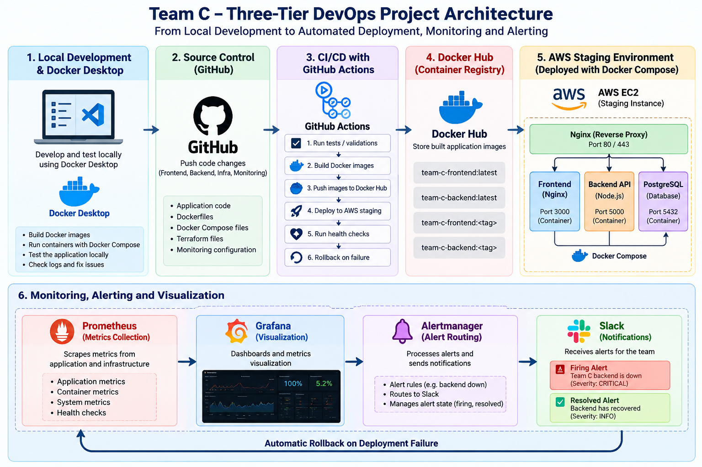

## Technology Stack

| Area | Technology | Purpose |
|---|---|---|
| Source control | Git, GitHub | Version control and collaboration |
| CI/CD | GitHub Actions | Validation, image publishing, staging deployment and failure handling |
| Infrastructure as Code | Terraform | Provision AWS infrastructure |
| Cloud | AWS EC2 | Hosts application and monitoring services |
| Containers | Docker, Docker Compose | Packages and runs services |
| Image registry | Docker Hub | Stores frontend and backend images |
| Web entry point | Nginx | Public HTTP entry point |
| Database | PostgreSQL | Persistent application data |
| Metrics | Prometheus | Scrapes application and monitoring targets |
| Dashboards | Grafana | Visualizes monitoring data |
| Alerting | Alertmanager | Routes Prometheus alerts |
| Notifications | Slack | Receives deployment and monitoring notifications |

## Repository Structure

Representative structure; update it if the repository changes.

```text
team-c-three-tier-devops/
├── .github/
│   └── workflows/
│       └── staging.yml
├── deploy/
│   ├── staging/
│   │   └── docker-compose.yml
│   └── production/
│       └── docker-compose.yml
├── monitoring/
│   ├── alertmanager/
│   │   └── alertmanager.yml
│   ├── grafana/
│   │   ├── dashboards/
│   │   │   └── team-c.json
│   │   └── provisioning/
│   └── prometheus/
│       ├── alerts.yml
│       └── prometheus.yml
├── scripts/
│   └── staging-rollback.sh
├── terraform/
├── README.md
└── docs/
    └── screenshots/
```

The staging workflow generates `monitoring-config.tar.gz` from `monitoring/`. If the workflow creates this archive automatically, it is a deployment artifact and normally does not need to be committed.

## Local Build and Deployment with Docker Desktop

Use Docker Desktop to build and run the application locally before pushing changes to GitHub or deploying to AWS. This gives you an early way to catch Dockerfile, image-build, configuration, and container-startup problems.

#### Prerequisites

- Docker Desktop installed and running.
- Docker Compose v2 available through Docker Desktop.
- The project's frontend and backend source code and Dockerfiles available locally.
- A local Compose file configured with `build:` contexts for the application services.

Open Docker Desktop and wait until its engine reports that it is running. In Git Bash, confirm the CLI can reach the engine:

```bash
docker --version
docker compose version
docker info
```

If `docker info` cannot connect, start Docker Desktop and wait for the engine to finish starting before continuing.

### Clone the repository

```bash
git clone https://github.com/Musty2025x/team-c-three-tier-devops.git
cd team-c-three-tier-devops
```

#### Build the application images locally

From the repository root, inspect the available Compose files and Dockerfiles first:

```bash
find . -maxdepth 4 \\( -iname 'Dockerfile' -o -iname '*compose*.yml' -o -iname '*compose*.yaml' \\) -print
```

Use a local Compose file that defines `build:` for the frontend and backend. For example, if your local Compose file is named `docker-compose.local.yml`:

```bash
docker compose -f docker-compose.local.yml config
docker compose -f docker-compose.local.yml build
```

The Compose file's `build.context` and `dockerfile` paths must match the actual repository layout. Do not run this example until `docker-compose.local.yml` exists and has been configured for local builds.

If the project does not yet have a local Compose file, create one based on the current app layout. The key pattern for each application service is:

```yaml
services:
  backend:
    build:
      context: ./backend
      dockerfile: Dockerfile
    # Add the environment variables and network settings
    # required by the backend and its database.

  frontend:
    build:
      context: ./frontend
      dockerfile: Dockerfile
    # Add the required frontend configuration.
```

This is a template, not a drop-in Compose file: update the build contexts, service settings, ports, networks, database service, and environment variables to match the actual source code. Keep the database on the internal Compose network and do not commit credentials.

## build Frontend and backend
```bash
cd frontend
npm install
npm run lint
npm run build

cd backend
npm install
npm run lint
```

#### Start and test the local application

After the local Compose file is configured, build and start the services:

```bash
cd ..
cp .env.example .env
docker compose -f docker-compose.yml up -d --build
docker compose ps
docker compose -f docker-compose.yml logs --tail=100
```

Use the local ports defined in your Compose configuration to open the application in a browser. If the backend exposes a health endpoint through the local web entry point, test it using the matching local port, for example:

- App: http://localhost
- API health: http://localhost/api/health
- Metrics: http://localhost/api/metrics
- Prometheus: http://localhost:9090
- Alertmanager: http://localhost:9093
- Grafana: http://localhost:3000

Only use that exact URL if your local Compose configuration publishes Nginx on port 80 and routes `/api/health` to the backend. Otherwise, adjust the URL to the actual local port and route.

To stop the local stack without deleting persistent volumes:

```bash
docker compose -f docker-compose.yml down
```

Avoid `docker compose down -v` unless you intentionally want to delete the local database volume and its data.

#### Verify the build in Docker Desktop

Open Docker Desktop and check:

- **Containers:** frontend, backend, and database containers are running.
- **Images:** locally built frontend and backend images appear in the image list.
- **Logs:** application containers start without repeated crash or connection errors.
- **Ports:** the published local ports match the Compose configuration.
- **Application:** the frontend loads and the health endpoint returns the expected response.

> **Screenshot evidence:**

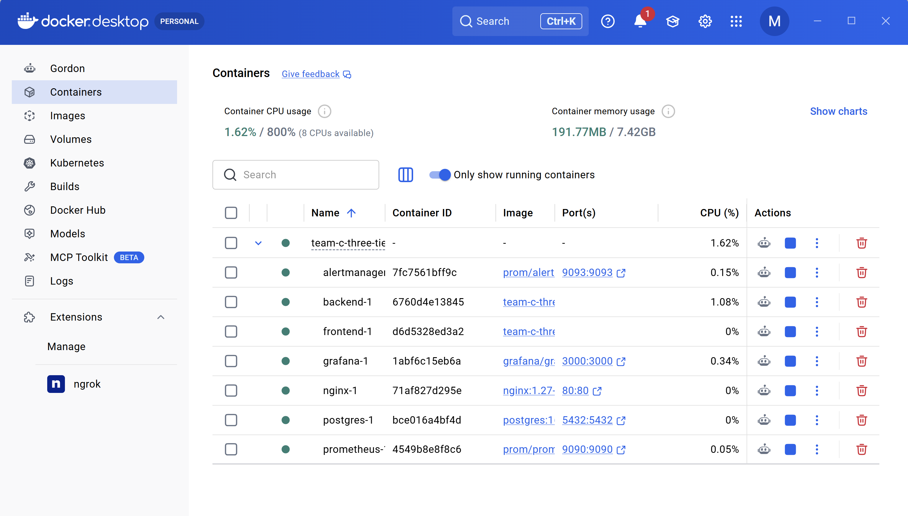

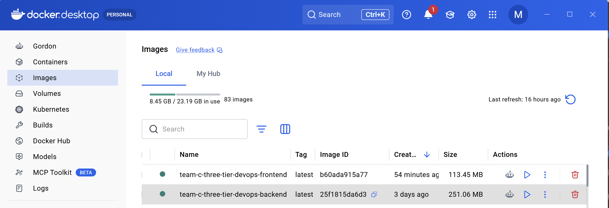

#### Recommended development-to-deployment flow

1. Make a code change locally.
2. Build the frontend and backend images with Docker Desktop.
3. Start the local Compose stack and test the application.
4. Review container logs and verify the health endpoint.
5. Commit and push the tested code to GitHub.
6. Let GitHub Actions run CI and the staging deployment workflow.
7. Verify the staging deployment and monitoring dashboards.

Local Docker Desktop testing is a development check; it does not replace the GitHub Actions CI checks or staging health checks.

## CI/CD Workflow

This stage starts **after local Docker Desktop build and testing**. Only push changes after the local application has been built and checked.

1. A developer commits and pushes locally tested changes to GitHub.
2. GitHub Actions runs the validation steps configured in the workflow.
3. The pipeline builds application images and publishes them to Docker Hub using configured image tags.
4. The staging workflow packages and transfers the Compose and monitoring configuration.
5. The workflow connects to the staging EC2 instance and deploys with Docker Compose.
6. Health checks validate the deployment.
7. After a successful deployment, the workflow records the known-good staging image tag.
8. If deployment checks fail, diagnostics run and the rollback script attempts to restore the known-good release.
9. GitHub Actions sends deployment-failure notifications to Slack. Prometheus alerts are separately routed through Alertmanager.

## Setup and Usage

### Prerequisites

- Git
- Docker and Docker Compose
- AWS account and credentials configured for Terraform
- Terraform CLI
- GitHub repository with Actions enabled
- Docker Hub account and repository access
- SSH access to the target EC2 instance
- GitHub Actions secrets and environment variables required by the current workflow

### Clone the repository

```bash
git clone https://github.com/Musty2025x/team-c-three-tier-devops.git
cd team-c-three-tier-devops
cd terraform
```

### Terraform validation

First change into the directory containing the intended Terraform configuration and review its backend, variables, AWS account, region, and expected costs.

```bash
terraform init
terraform fmt -check
terraform validate
terraform plan
```

Get outputs:

```bash
terraform output
```

Only apply after reviewing the plan:

```bash
terraform apply
```

Do not run Terraform from an arbitrary directory. Use the correct Terraform working directory and backend configuration.

### Inspect the Compose configuration

```bash
docker compose -f deploy/staging/docker-compose.yml config
```

The required environment file and variables depend on the current Compose configuration. Never commit production credentials.

### GitHub Actions configuration

Configure the repository/environment secrets required by the current workflow. Never put secret values in this README.

Before deployment, verify that the image tag exists in Docker Hub, the target environment is correct, required secrets are configured, Compose validation succeeds, and the rollback state points to a known-good release.

## GitHub configuration

Create these repository secrets:

```text
DOCKERHUB_USERNAME
DOCKERHUB_TOKEN

STAGING_HOST
STAGING_SSH_KEY
STAGING_SSH_USER

PRODUCTION_HOST
PRODUCTION_SSH_KEY
PRODUCTION_SSH_USER

STAGING_DB_PASSWORD
STAGING_GRAFANA_PASSWORD
PRODUCTION_DB_PASSWORD
PRODUCTION_GRAFANA_PASSWORD
ALERTMANAGER_WEBHOOK_URL
```

Set `ALERTMANAGER_WEBHOOK_URL` to a Slack incoming webhook URL. This repository
secret is used for staging Alertmanager alerts and for failed main-branch CI,
staging, and production workflow notifications.

Recommended GitHub Environments:

### staging

No required reviewers.

### production

Add one or more required reviewers under:

`Settings → Environments → production`

This creates the manual production approval gate.

## Docker Hub

Create repositories:

```text
<dockerhub-user>/team-c-frontend
<dockerhub-user>/team-c-backend
```

The workflows use:

```text
<dockerhub-user>/team-c-frontend:<git-sha>
<dockerhub-user>/team-c-backend:<git-sha>
```

Using the Git SHA makes rollback deterministic.

## AWS infrastructure

Terraform provisions:

- VPC
- Public subnet
- Internet gateway
- Route table
- Security group
- Staging EC2
- Production EC2
- IAM instance role/profile
- CloudWatch permissions
- User-data bootstrap

For a classroom/demo deployment, the default instance type is `t3.micro`. Check the current AWS Free Tier eligibility for your account/region before creating resources.

### Remote state

Create an S3 bucket first and use `terraform/backend.tf.example` as the starting point for the backend configuration.

Example:

```hcl
terraform {
  backend "s3" {
    bucket = "YOUR-UNIQUE-TERRAFORM-STATE-BUCKET"
    key    = "team-c/terraform.tfstate"
    region = "us-east-1"
    encrypt = true
  }
}
```

Do not commit Terraform state or AWS credentials.

Destroy when finished:

```bash
terraform destroy -auto-approve
```
## Deployment

The deployment workflow copies the production compose files and environment file to EC2, then executes:

```bash
docker compose pull
docker compose up -d
docker compose ps
```

The server stores the previous screenshots/image tags in:

```text
/opt/team-c/releases/
```

This gives the project a simple, auditable rollback mechanism.

## Rollback

SSH to the affected server only for emergency investigation. Normal deployment is automated.

```bash
cd /opt/team-c
./rollback.sh
```

The script reads the last known-good release and redeploys those screenshots/image tags.

### Successful CI/CD screenshot

Save as `docs/screenshots/github-actions-success.png`.

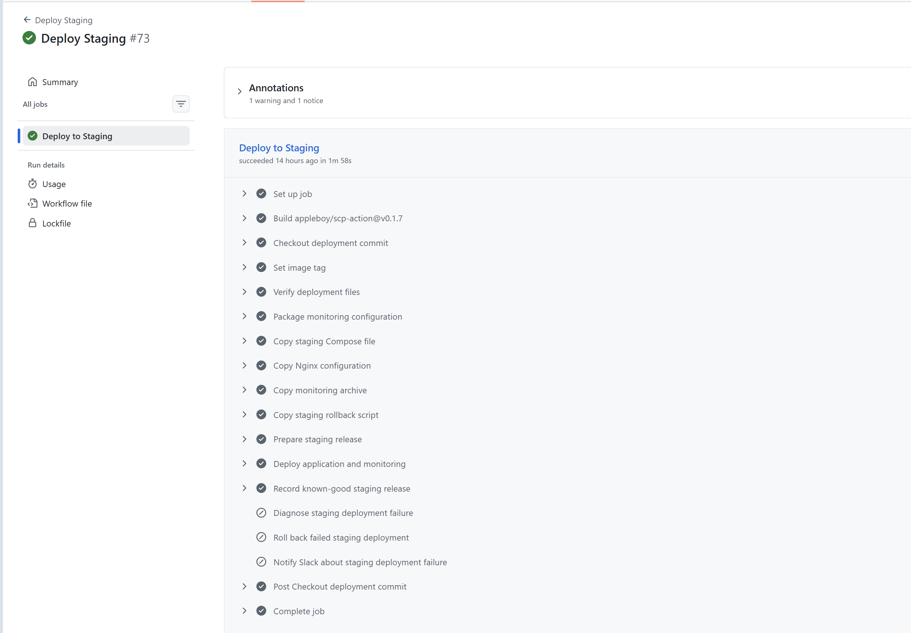

### Docker Hub screenshot

Save as `docs/screenshots/dockerhub-images.png`.

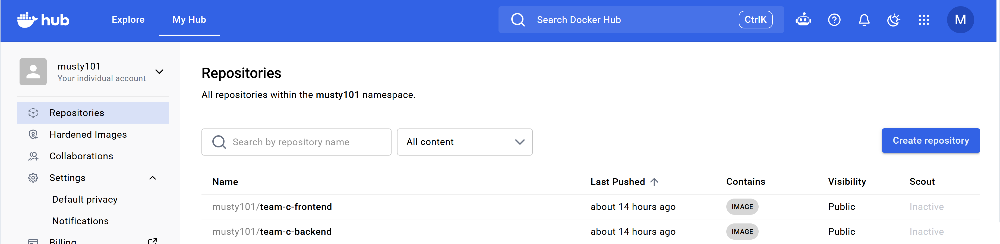

## Deployment and Health Checks

Run on the staging EC2 instance:

ssh into the staging EC2 instance and check that the backend is running and healthy:

```bash
ssh -i <staging-ssh-key> <staging-ssh-user>@<staging-host>
ssh -i "team-c-three-tier-deployer.pem" ubuntu@ec2-44-197-190-142.compute-1.amazonaws.com
curl -i http://localhost/api/health
```

A successful response should return HTTP `200` with the backend health information. A health endpoint alone does not prove every application feature works; test application functionality and database schema as well.

Useful Docker Compose checks (run from the correct release directory and with the relevant environment file):

```bash
docker compose ps
```

Nginx is intended to be the public entry point. Avoid publishing backend or database ports directly to the internet without a documented requirement.

### Staging application screenshot

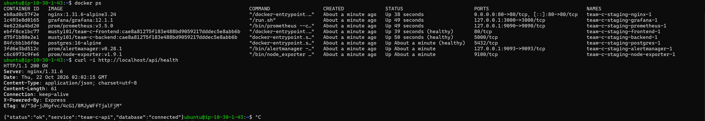

## Monitoring and Alerting

Prometheus scrapes the backend, Prometheus itself, Alertmanager, and Node Exporter. Grafana provides dashboards, while Alertmanager routes alerts to Slack.

### Configured alert rules

| Alert | Condition | Pending period | Severity |
|---|---|---:|---|
| `BackendDown` | `up{job="backend"} == 0` | 60 seconds | Critical |
| `PrometheusDown` | `up{job="prometheus"} == 0` | 60 seconds | Critical |
| `AlertmanagerDown` | `up{job="alertmanager"} == 0` | 60 seconds | Critical |
| `HighErrorRate` | HTTP 5xx responses exceed 5% of requests | 5 minutes | Warning |

These reflect the alert rules observed during testing. Keep this table synchronized with `monitoring/prometheus/alerts.yml`.

### Monitoring verification commands

```bash
# Prometheus scrape targets
curl -s http://localhost:9090/api/v1/targets

# Prometheus alert rules
curl -s http://localhost:9090/api/v1/rules

# Current Prometheus alerts
curl -s http://localhost:9090/api/v1/alerts

# Alertmanager active alerts
curl -s http://localhost:9093/api/v2/alerts
```

Append `| jq .` to format JSON if `jq` is installed.

### Grafana dashboard screenshot
Grafana container is bound to 127.0.0.1:3000, so it isn't directly accessible over the public internet.

```bash
ssh -i ~/.ssh/team-c-three-tier-deployer \
  -L 3000:127.0.0.1:3000 \
  ubuntu@YOUR_STAGING_PUBLIC_IP
```
Then open `http://localhost:3000` in a browser and log in with the configured Grafana credentials.

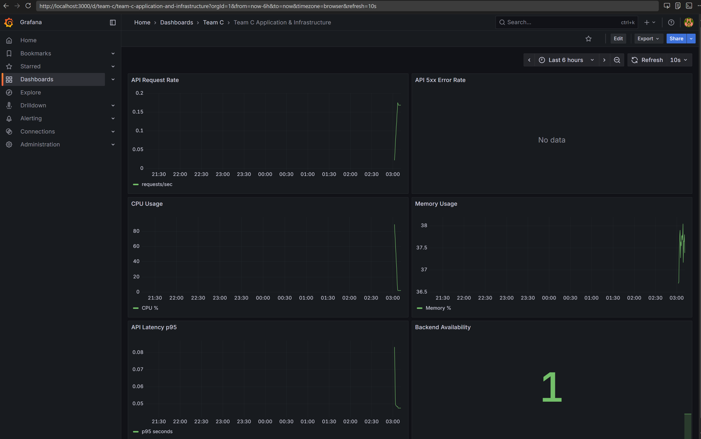

### Prometheus targets screenshot

prometheus targets can be viewed in the Prometheus web UI at `http://localhost:9090/targets`. The targets page shows the scrape status, last scrape time, and any errors.

```bash
ssh -i ~/.ssh/team-c-three-tier-deployer \
  -L 9090:127.0.0.1:9090 \
  ubuntu@YOUR_STAGING_PUBLIC_IP
```
Then open `http://localhost:9090/targets` in a browser.

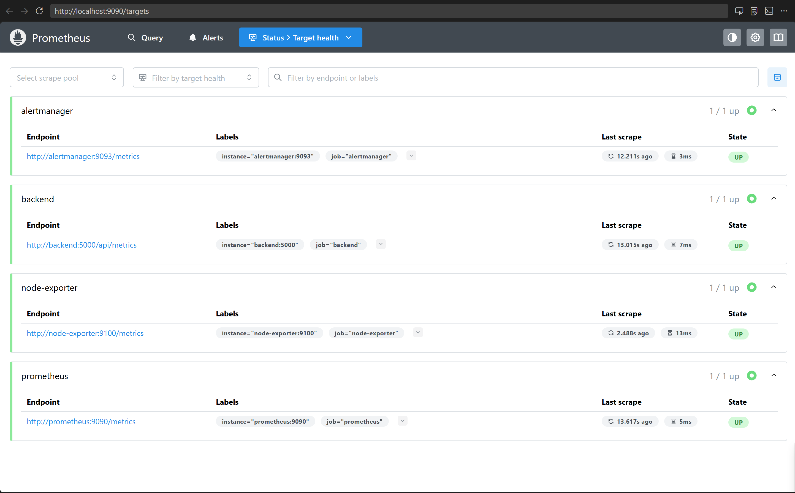

### Slack monitoring alert screenshot
Slack receives Prometheus alerts routed through Alertmanager. The `BackendDown` alert is triggered when the backend service is unreachable.

Trigger a `BackendDown` alert by stopping the backend container on the staging EC2 instance:

```bash
sudo -u deployer docker compose \
  -p team-c-staging \
  --env-file /opt/team-c/releases/git-sha/.env \
  -f /opt/team-c/releases/git-sha/docker-compose.yml \
  stop backend
```
confirm backend is down:

```bash
curl -i http://localhost/api/health
```
Restore the backend container after testing:

```bash
sudo -u deployer docker compose \
  -p team-c-staging \
  --env-file /opt/team-c/releases/git-sha/.env \
  -f /opt/team-c/releases/git-sha/docker-compose.yml \
  start backend
```

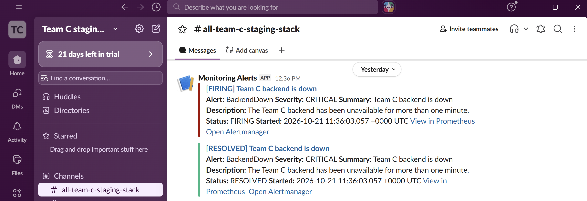

The project test confirmed that a `BackendDown` alert was delivered to Slack through Prometheus/Alertmanager. A separate GitHub Actions notification was also delivered for a failed staging deployment.

## Rollback and Recovery

The staging workflow includes a rollback step that attempts to restore the last known-good release if deployment checks fail.

During testing, the deliberately invalid image tag `rollback-demo-invalid` failed to pull. The rollback script restored the recorded known-good release and the staging health check succeeded.

Known-good release observed during that test:

```text
7885d63caa8003826c0a3fe4bcd8dd2bb461737f
```

This identifies the test release and should not be treated as a permanent release identifier.

**Important:** GitHub Actions triggers rollback when deployment checks fail. Prometheus and Alertmanager send monitoring notifications, but a Prometheus alert does not automatically trigger rollback in the current design.

### Rollback workflow screenshot

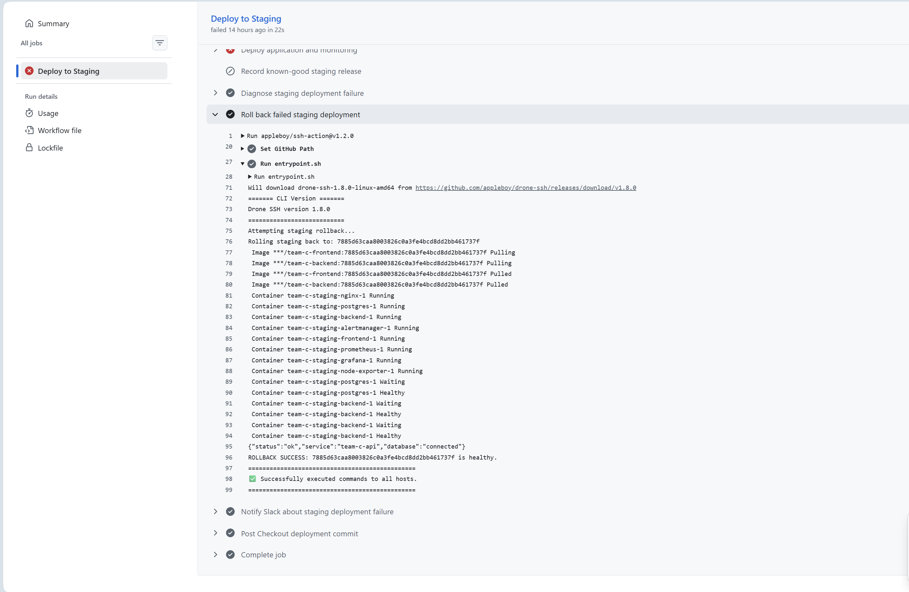

### Slack deployment failure screenshot

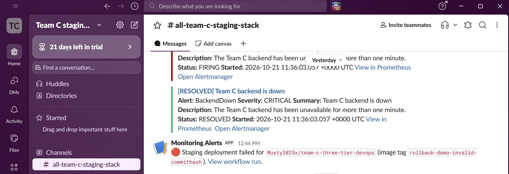


## Screenshot Evidence

| Evidence | Suggested filename | What it demonstrates |
|---|---|---|
| Architecture diagram | `architecture.png` | Components and traffic flow |
| Docker Desktop local containers | `docker-desktop-local-containers.png` | Local Compose services are running |
| Docker Desktop local images | `docker-desktop-images.png` | Frontend and backend images build locally |
| Successful GitHub Actions run | `github-actions-success.png` | CI/CD completes |
| Docker Hub images | `dockerhub-images.png` | Images and tags are published |
| Staging application | `staging-application.png` | Application responds after deployment |
| Grafana dashboard | `grafana-dashboard.png` | Metrics are visualized |
| Prometheus targets | `prometheus-targets.png` | Scrape targets are healthy |
| Slack monitoring alert | `slack-backend-alert.png` | Prometheus alert reaches Slack |
| Rollback workflow | `rollback-workflow.png` | Failed deployment and recovery |
| Slack deployment alert | `slack-deployment-failure.png` | Workflow failure notification reaches Slack |
| Terraform provisioning | `terraform-provisioning.png` | Infrastructure provisioning evidence |

## Challenges and Lessons Learned

- **Deployment failures:** workflow logs and explicit validation steps help isolate issues.
- **Image tagging:** traceable tags make releases easier to identify and roll back.
- **Remote access:** SSH keys, user permissions, and remote shell behavior require careful configuration.
- **Health checks:** container status alone is insufficient; verify HTTP behavior and database connectivity.
- **Observability:** validate scrape targets, alert rules, Alertmanager routing, and actual notification delivery.
- **Recovery:** preserve persistent database data and test rollback without destructive cleanup.
- **Application correctness:** a healthy endpoint does not guarantee every feature or database table is available.

## Security Notes

- Never commit `.env` files containing secrets, SSH private keys, Docker Hub tokens, Slack webhooks, or database passwords.
- Store sensitive GitHub Actions values in repository or environment secrets.
- Restrict inbound security-group rules to required ports and sources.
- Keep PostgreSQL and the backend API private unless external access is explicitly required.
- Use least-privilege IAM policies and SSH access.
- Redact sensitive values from screenshots and logs.
- Review Terraform plans before applying changes and clean up unused cloud resources to control costs.

## Future Improvements

- Add integration tests and database migration validation.
- Add a production deployment approval gate.
- Use immutable release tags and retain a documented release history.
- Add PostgreSQL backup and restore testing.
- Improve dashboards with application-specific latency, request rate, and error metrics.
- Test alert resolution and notification deduplication.
- Consider a secrets manager for runtime credentials.
- Document disaster recovery and rollback procedures.

## Project Links

- **GitHub repository:** https://github.com/Musty2025x/team-c-three-tier-devops
- **Docker Hub backend image:** `musty101/team-c-backend`
- **Docker Hub frontend image:** `musty101/team-c-frontend`

> Update this README.md whenever the architecture, workflow, alert rules, deployment steps, or screenshots change. Verify repository paths and commands against the current code before describing the project as production-ready.
